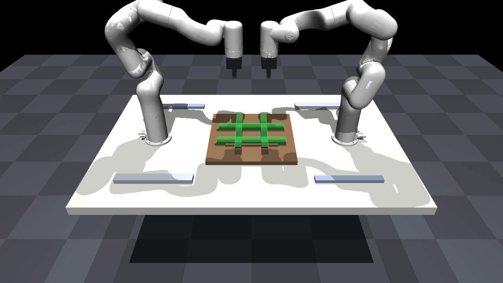

# Hash assembly with two UFACTORY xArm6

Technical assignment, Scientific Assistant in Industrial Robotics and Manufacturing,
Advanced Manufacturing Lab (am|z), ETH Zurich. Drawing: AMZ-SA-26-001 rev. A.

Two xArm6 robots pick four cold-formed U-profiles from magazines and place them
into a machined fixture, where the hash assembly is located, clamped and fixed.
Core idea: **the robot transports, the fixture positions, measurement verifies**:
the assembly tolerances (±0.05 mm) are tighter than the robot repeatability (±0.1 mm).



## Quick start

```bash
python -m venv .venv
# Windows: .venv\Scripts\activate      macOS/Linux: source .venv/bin/activate
pip install -r requirements.txt

python scripts/view_scene.py           # open the cell in the MuJoCo viewer
python scripts/view_scene.py --demo    # robot A picks a Pos 1 profile and lifts it
python -m pytest                       # scene and reachability tests
```

On macOS, run the viewer with `mjpython` instead of `python`.
In the viewer, the green transparent profiles are the nominal assembled positions.

## Layout

```
config/cell.yaml           all cell parameters (frames, robots, gripper, fixture, parts)
models/xarm6/meshes/       xArm6 meshes from xarm_ros2 (BSD licence, see LICENSE_xarm_ros2)
src/hash_cell/scene.py     builds models/scene.xml (MJCF) from cell.yaml
src/hash_cell/ik.py        damped least-squares IK, symmetric-gripper variant
src/hash_cell/frames.py    tool orientations, grasp frames
src/hash_cell/robot_interface.py   abstract Robot (same task code for sim and real robot)
src/hash_cell/backends/    MuJoCo backend (xArm-Python-SDK backend to come)
scripts/view_scene.py      viewer and demo
tests/                     pytest, run in CI (GitHub Actions)
```

## Model notes

- xArm6 kinematics, joint limits and link inertias come from the official
  [xarm_ros2](https://github.com/xArm-Developer/xarm_ros2) description; the MJCF is
  generated, not converted from URDF.
- The gripper is a generic parallel gripper made of primitives, force-limited (20 N per finger).
- Profiles are modelled as three boxes (web + two flanges), steel density.
- Sim-only position-servo gains; real-robot control goes through the xArm SDK.
