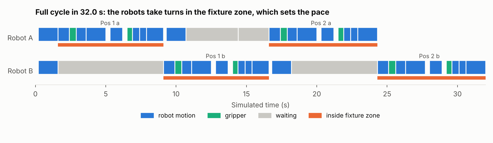
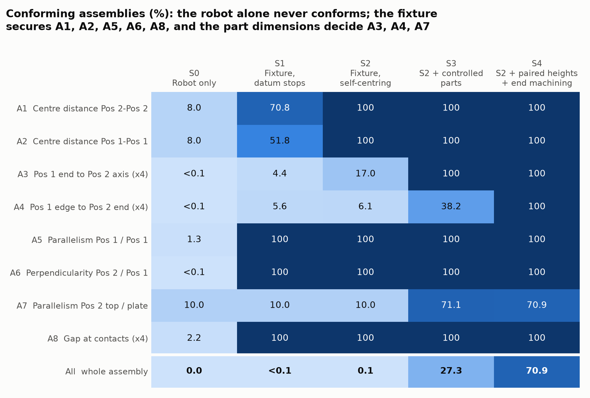

# Hash assembly with two UFACTORY xArm6

Technical assignment, Scientific Assistant in Industrial Robotics and Manufacturing,
Advanced Manufacturing Lab (am|z), ETH Zurich. Drawing: AMZ-SA-26-001 rev. A.

Two xArm6 robots pick four cold-formed U-profiles from magazines and place them
into a machined fixture, where the hash assembly is located, clamped and fixed.
Core idea: **the robot transports, the fixture positions, measurement verifies**:
the assembly tolerances (±0.05 mm) are tighter than the robot repeatability (±0.1 mm).


## Quick start

```bash
python -m venv .venv
# Windows: .venv\Scripts\activate      macOS/Linux: source .venv/bin/activate
pip install -r requirements.txt

python scripts/view_scene.py           # open the cell in the MuJoCo viewer
python scripts/view_scene.py --demo    # robot A picks a Pos 1 profile and lifts it
python scripts/run_cycle.py --viewer   # full two-robot cycle in the viewer
python scripts/run_cycle.py --video    # same, rendered to docs/cycle.mp4 (needs ffmpeg)
python scripts/run_placement_study.py # free placement with/without robot error
python scripts/analyze_xarm6.py        # singularity margins, dexterity map of the xArm6
python scripts/run_montecarlo.py       # tolerance analysis -> docs/figures
python -m pytest                       # scene, reachability and tolerance-model tests
```

On macOS, run the viewer with `mjpython` instead of `python`.
In the viewer, the green transparent profiles are the nominal assembled positions.

## Layout

```
config/cell.yaml           all cell parameters (frames, robots, gripper, fixture, parts)
models/xarm6/meshes/       xArm6 meshes from xarm_ros2 (BSD licence, see LICENSE_xarm_ros2)
src/hash_cell/scene.py     builds models/scene.xml (MJCF) from cell.yaml
src/hash_cell/ik.py        damped least-squares IK, symmetric-gripper variant
src/hash_cell/frames.py    tool orientations, grasp frames
src/hash_cell/robot_interface.py   abstract Robot (same task code for sim and real robot)
src/hash_cell/backends/    MuJoCo backend (xArm-Python-SDK backend to come)
src/hash_cell/cycle.py     two-robot cycle: programs, zone lock, precedence, placement errors
src/hash_cell/tolerance/   tolerance chains and Monte-Carlo (params.py lists every assumption)
scripts/run_montecarlo.py  tolerance analysis, figures and CSV in docs/figures
scripts/view_scene.py      viewer and demo
scripts/run_cycle.py       full cycle: viewer, video, timeline
scripts/run_placement_study.py  free placement with robot error
scripts/analyze_xarm6.py   xArm6 singularity margins and dexterity map
docs/report/               technical report (LaTeX source and PDF)
tests/                     pytest, run in CI (GitHub Actions)
```

## Assembly cycle

`src/hash_cell/cycle.py` runs both robots concurrently: each robot program is a
generator advanced once per simulation step. A zone lock lets only one robot into
the fixture zone at a time (a robot grips its part only once it holds the lock), and a
precedence condition holds the Pos 2 until both Pos 1 are placed. Before each placement the part position in the gripper is
measured (a camera or laser check in the real cell) so the robot places the part,
not its TCP. Simulated cycle time: 32 s.



Free placement (no active fixture): parts land about 0.7 mm from nominal, up to 1.6 mm
with a ±1 mm robot error, bounded by the 1.5 mm lead-in clearance of the passive rails;
1 % within ±0.05 mm.

The xArm6 analysis (`scripts/analyze_xarm6.py`) found that with the tool vertical the
dexterity drops on a ring ~300 mm from the base (wrist joint J5 -> 0): the magazines were
moved to 450 mm, which raised the dexterity of the pick poses fivefold. See
`docs/figures/fig_free_placement.png`.

## Tolerance analysis (Monte-Carlo)

`src/hash_cell/tolerance/` models the eight drawing characteristics A1-A8 for
100 000 simulated assemblies per scenario. All assumed inputs are in
`tolerance/params.py`, marked ASSUMPTION, so they can be replaced by measurements.

| Scenario | Placement | Conforming assemblies |
| --- | --- | --- |
| S0 | robot only, nominal coordinates | 0 % |
| S1 | fixture, one-sided datum stops | < 0.1 % |
| S2 | fixture, self-centring jaws | 0.1 % |
| S3 | S2 + lengths cut to ±0.05, Pos 1 paired by height | 27 % |
| S4 | S2 + paired heights + ends machined after joining | 71 % |

Findings: the fixture secures A1, A2, A5, A6 and A8; the closed chain
100 + 120 + 100 = 320 makes A3 depend on the Pos 1 length (needs about ±0.1 mm, the
drawing allows ±0.5); A4 is limited by the Pos 1 width (±0.3); A7 by the height
difference of the two Pos 1. See `docs/figures/`.



## Model notes

- xArm6 kinematics, joint limits and link inertias come from the official
  [xarm_ros2](https://github.com/xArm-Developer/xarm_ros2) description; the MJCF is
  generated, not converted from URDF.
- The gripper is a generic parallel gripper made of primitives, force-limited (20 N per finger).
- Profiles are modelled as three boxes (web + two flanges), steel density.
- Sim-only position-servo gains; real-robot control goes through the xArm SDK.
